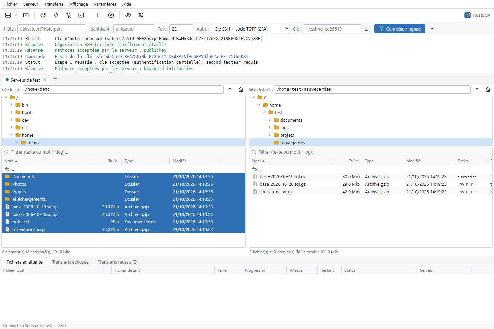
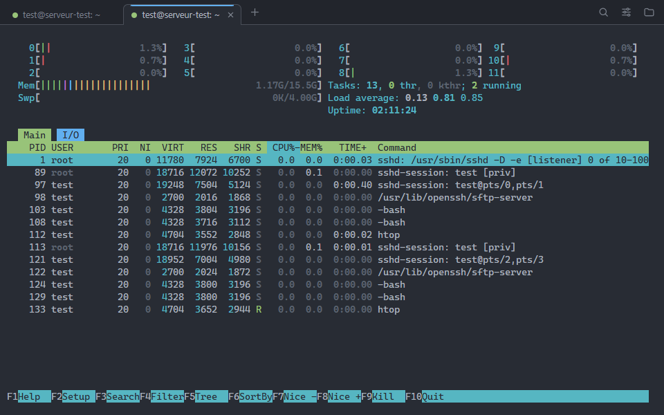

# RustSCP — SCP/SFTP/FTP client for Linux and Windows

[](https://github.com/JeanJacquesSerpoul/rustscp/actions/workflows/ci.yml)

**English** · [Français](README.md)

A graphical client written in **Rust · Tauri · Leptos**, inspired by FileZilla, built for
servers that require **an SSH key and a TOTP code at the same time**
(`AuthenticationMethods publickey,keyboard-interactive` + `pam_google_authenticator`),
which FileZilla does not support.

- native Rust networking core (`russh`, `russh-sftp`, `suppaftp`): SSH, SCP, SFTP, FTP/FTPS,
  transfer queue;
- Leptos user interface compiled to WebAssembly, displayed by Tauri 2 (WebKitGTK);
- types and helpers shared between both (`shared/`).



## Installation

Ready-to-use packages (`.deb`, AppImage, standalone binary) are attached to each
[release](https://github.com/JeanJacquesSerpoul/rustscp/releases).

To build from source:

```bash
./install.sh
```

The script builds the application in release mode, installs `rustscp` into
`~/.local/bin` and adds a "RustSCP" entry to the applications menu.
`.deb` / AppImage packages: `cargo tauri build`.

Requirements: stable Rust, the `wasm32-unknown-unknown` target, `trunk`, `tauri-cli` 2,
WebKitGTK 4.1 and OpenSSL (Debian: `libwebkit2gtk-4.1-dev libssl-dev libdbus-1-dev`).

Development: `cargo tauri dev`.

### Windows

In PowerShell, from the repository root:

```powershell
powershell -ExecutionPolicy Bypass -File build-windows.ps1
```

The script produces `target\release\rustscp.exe` (standalone executable) and an
NSIS installer in `target\release\bundle\nsis\`; `-NoInstaller` builds only the
executable.

Requirements: stable Rust (MSVC) with the Visual Studio Build Tools ("Desktop development
with C++" workload), the `wasm32-unknown-unknown` target, `trunk`, `tauri-cli` 2.
WebView2 ships with Windows 10/11. NASM is optional (prebuilt `aws-lc-sys` objects are
used otherwise).

On Windows, secrets are kept in the Credential Manager, the configuration in
`%APPDATA%\rustscp\`, and the SSH agent used is OpenSSH for Windows' (or Pageant).
The local pane's "/" root lists the drives.

## Languages

The interface and messages are available in **French** and **English**.
By default the language follows the system locale (`LANG`, `LC_MESSAGES`…): French if
it starts with `fr`, English otherwise. It can be forced in **Settings → Language**.

## Multi-factor authentication

The engine follows the steps required by the server:

1. **Public key**: key file (ed25519, ECDSA, RSA, encrypted or not, in OpenSSH, PEM or
   PuTTY `.ppk` v2/v3 format, `*-cert.pub` certificate detected) and/or SSH agent keys
   (ssh-agent; on Windows, the OpenSSH agent or Pageant). The server answers
   "partial success".
2. **keyboard-interactive**: each server prompt is classified (TOTP code, password,
   other):
   - TOTP code **asked** in a dedicated dialog, or
   - TOTP code **generated automatically** from the stored secret
     (base32 or the QR code's `otpauth://` URI). The Site Manager shows the current
     code so you can check it matches your authenticator app.
3. Password if the server requires it (alone, or before/after the TOTP).

The log shows each step ("Step 1 succeeded: key accepted (partial authentication),
second factor required"…).

A code that has already been used is never sent again: if a reconnection happens
within the same 30 s window, RustSCP waits for the next code (`DISALLOW_REUSE`
compatible).

### One TOTP code, many parallel transfers

FileZilla opens one connection per simultaneous transfer: with TOTP, each one would
need a new code. RustSCP **multiplexes**: browsing and the N parallel transfers are
separate SSH channels over **a single authenticated connection**.

## Features

- Site Manager (folders, duplication), quickconnect (`user@host:port`) with history,
  multiple tabs.
- Secrets (password, passphrase, TOTP secret) stored in the **system keyring**
  (Secret Service / KWallet), never in clear text on disk.
- Host key verification (`~/.ssh/known_hosts` + `~/.config/rustscp/known_hosts`),
  warning when a key changes.
- **Native SCP** protocol (implemented directly on the channel, no external program)
  or **SFTP**; browsing via SFTP, or via shell commands (`find`) on "SCP only"
  servers; automatic fallback to SFTP if the server refuses commands.
- **FTP** and **FTPS** (explicit TLS, `AUTH TLS`) with a password or anonymous access
  (`anonymous`): passive mode, MLSD or LIST listings (Unix and DOS), one connection per
  parallel transfer, modification time kept (MDTM / MFMT), chmod through `SITE CHMOD`.
  The TLS certificate is checked against the system store; an unknown (self-signed)
  certificate is shown with its fingerprint, like an SSH host key, and can be saved
  (`known_certs`).
- Local / remote panes with directory tree, instant filter (text or `*.log`),
  sorting, resizable columns, hidden files, drag and drop in both directions
  (including from the desktop file manager), remote moves by drag and drop.
- Remote operations: create folder/file, rename, delete (recursive), chmod
  (recursive), copy path, **open** (download, open with the application associated
  with the file type) and **view/edit** (same with the default text editor, whatever
  the extension), upload offered on save.
- Transfer queue: queued / failed / successful, progress, speed, time remaining,
  cancel, retry, pause; overwrite policy (ask, overwrite, if newer, if size differs,
  rename, skip, "for the whole queue").
- Transparent reconnection if the connection drops during transfers.
- Built-in **SSH terminal** (see below), on the same authenticated connection.
- Light / dark theme following the desktop; French or English interface.

### Keyboard shortcuts

| Key | Action |
| --- | --- |
| Ctrl+S | Site Manager |
| Ctrl+T / Ctrl+W | New tab / close tab |
| F5 | Refresh |
| Ctrl+R | Reconnect |
| Ctrl+Shift+D | Disconnect |
| Ctrl+Shift+T | Open SSH terminal |
| Backspace | Parent folder |
| Enter / double-click | Open folder / transfer file |
| Ctrl+U / Ctrl+D | Upload / download the selection |
| F2, Del, F7 | Rename, delete, new folder (remote) |
| Ctrl+A, letters | Select all, type-ahead search |
| Ctrl+H | Hidden files |
| Ctrl+Q | Quit |

## SSH terminal



Every SSH site (SCP / SFTP — not FTP) can open a **terminal**: "Terminal" button in
the Site Manager, toolbar button or **Server → Open SSH terminal** menu
(Ctrl+Shift+T), and **Open terminal here** in the remote pane menu (starts in the
displayed or selected folder).

- **No new TOTP code**: the terminal is one more channel on the already
  authenticated connection (like transfers); if it dropped, it is re-established.
- **xterm.js 6** emulation (`xterm-256color`, 24-bit colour, Unicode 11 and emoji,
  mouse, alternate screen, bracketed paste, Sixel / iTerm images), **GPU (WebGL)**
  rendering with automatic fallback, output batching and flow control: `cat`-ing a
  huge file freezes neither the display nor the transfers.
- Tabs in the terminal window (new tab in the current folder when the shell reports
  it through OSC 7), activity and bell shown on the tab, title set by the shell.
- Scrollback search (case, whole word, regular expression, counter), clickable
  links (Ctrl+click), copy / paste (copy on select, middle click, optional right
  click), OSC 52 (copy from vim / tmux).
- Themes (automatic light / dark, One Dark, Dracula, Nord, Gruvbox, Solarized…),
  font, size (Ctrl+wheel, Ctrl+= / Ctrl+- / Ctrl+0), line height, cursor,
  scrollback: settings shared by all windows (`terminal.json`).
- End of session: exit code shown, Enter restarts the shell.

| Key (terminal) | Action |
| --- | --- |
| Ctrl+Shift+C / Ctrl+Shift+V | Copy / paste (also Ctrl+Insert / Shift+Insert) |
| Ctrl+Shift+F, F3 / Shift+F3 | Find, next / previous |
| Ctrl+Shift+T / Ctrl+Shift+W | New tab / close tab |
| Ctrl+Tab, Ctrl+PgDn / Ctrl+PgUp | Next / previous tab |
| Ctrl+Shift+A / Ctrl+Shift+K | Select all / clear screen |

## Performance

Measured locally (release build, Docker server): SCP 211 MiB/s upload and 422 MiB/s
download, SFTP 253 MiB/s upload and 422 MiB/s download.

- Virtualized lists (only visible rows are drawn), sorting and filtering in
  Rust/WebAssembly: folders with tens of thousands of entries stay smooth.
- All networking is asynchronous (tokio), off the UI; listings are cached and the
  displayed content refreshes without losing the selection.
- 16 MiB SSH window per channel, pipelined SFTP (48 requests of 64 KiB in flight,
  for reads and writes), transfer queue synchronized incrementally.

## Tests

A test server (Docker) requires key + TOTP:

```bash
tests/server/run.sh
```

A second one (vsftpd) serves FTP and FTPS (self-signed certificate) on `127.0.0.1:2121`,
user `test`, password `test`:

```bash
tests/ftp/run.sh
```

```bash
cargo test --workspace
```

GitHub continuous integration (`.github/workflows/ci.yml`) checks formatting and
Clippy (native and wasm32) and runs all tests against these Docker servers
(`RUSTSCP_REQUIRE_SERVER=1`: the tests then fail if a server is missing). On a
`v*` tag or a manual run, it also builds the `.deb` and AppImage packages.

Throughput (release mode):

```bash
cargo test --release -p rustscp --test integration bench -- --ignored --nocapture
```

Server: `127.0.0.1:2222`, user `test`, key `tests/server/test_key`,
TOTP secret `JBSWY3DPEHPK3PXP` (enter it in an authenticator app or in the
Site Manager).

### Interface in a browser (development)

```bash
cargo run -p rustscp-devbridge   # core on 127.0.0.1:1421
trunk serve                      # interface on localhost:1420
```

Outside Tauri, `frontend/devshim.js` connects the interface to this HTTP bridge
(no effect in the application). `RUSTSCP_MEMORY_SECRETS=1` keeps secrets in memory.

## Layout

```
shared/      common types (sites, settings, transfers, dialogs), helpers and i18n
src-tauri/   ssh.rs (connection + multi-factor auth), scp.rs (SCP protocol),
             sftp.rs (pipelined SFTP), remotefs.rs (SFTP / shell / FTP),
             ftp.rs (FTP / FTPS, TLS certificate checking),
             transfer.rs (parallel queue, remote editing), sites.rs, config.rs,
             totp.rs, local.rs, terminal.rs (interactive shell, PTY),
             commands.rs (Tauri commands), ui.rs (events)
devbridge/   development HTTP bridge (interface in a browser)
frontend/    app.rs, panes.rs (lists and trees), queue.rs, dialogs.rs,
             sitemanager.rs, actions.rs, state.rs, layout.rs, icons.rs, styles.css,
             terminal.rs + terminal.js (terminal window), xterm/ (xterm.js)
```

Configuration: `~/.config/rustscp/` (`sites.json`, `settings.json`, `terminal.json`, `known_hosts`,
`known_certs`).

## License

Released under the MIT license: see [LICENSE](LICENSE).
